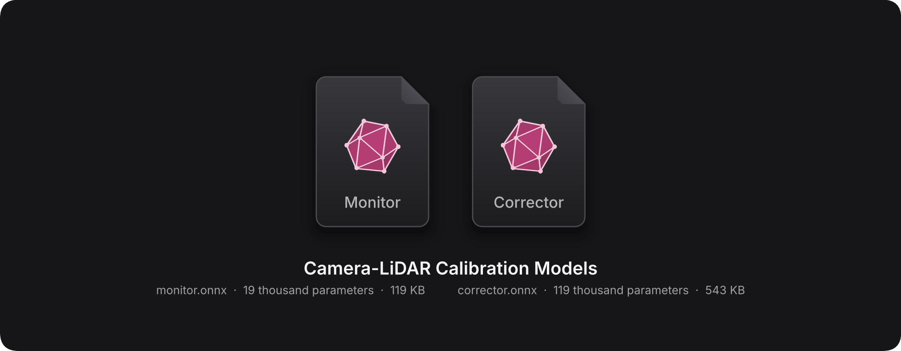
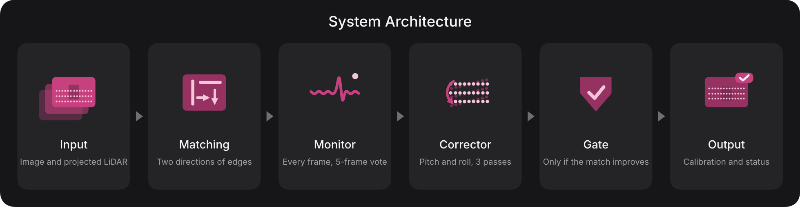
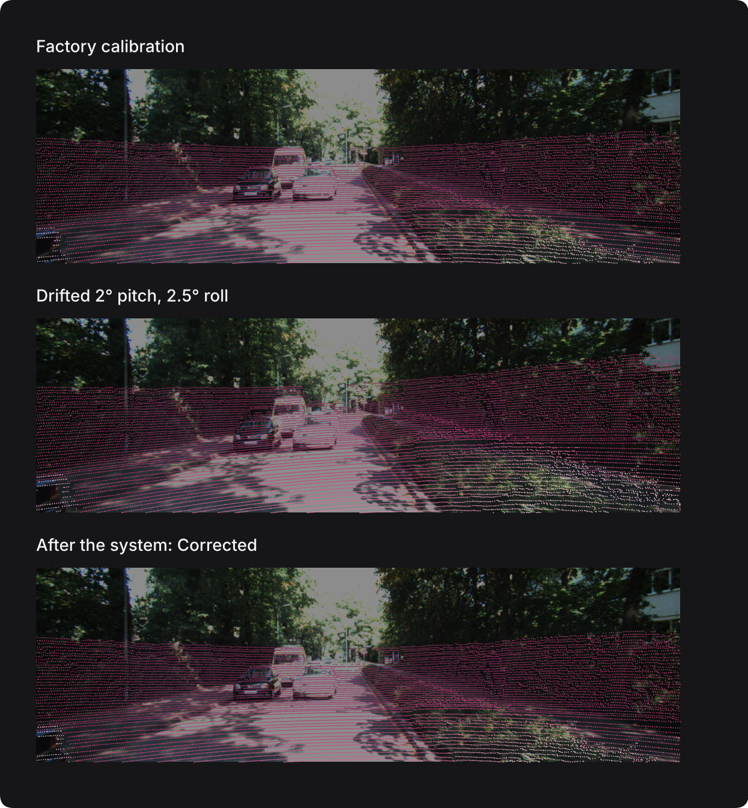
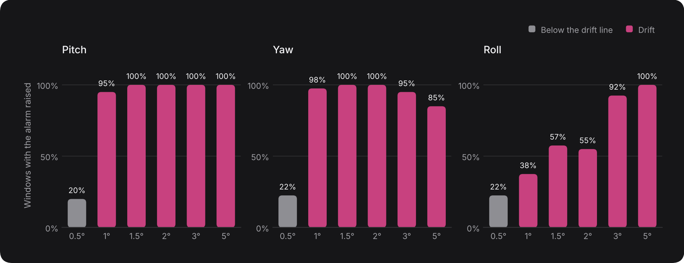
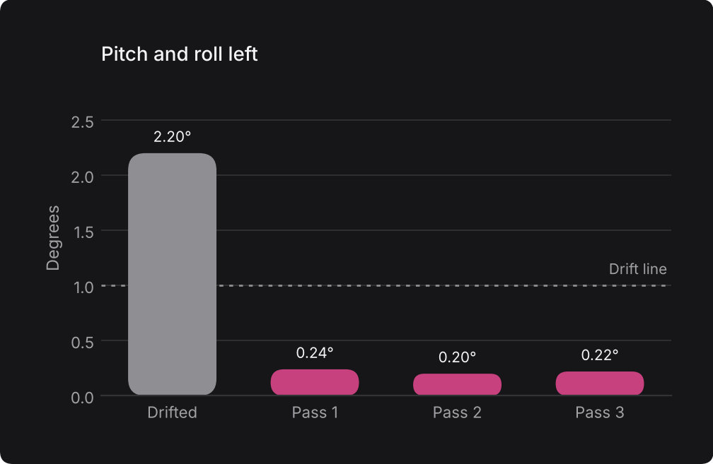
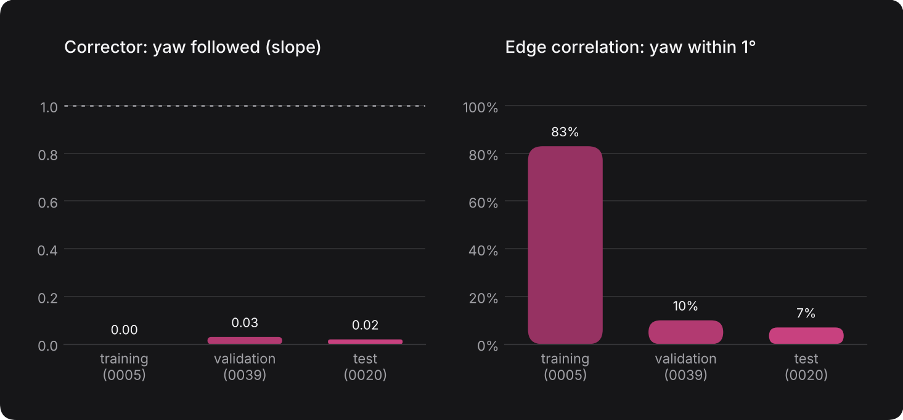

# Camera-LiDAR Fusion



Camera-LiDAR Fusion keeps a camera and a LiDAR aligned while a vehicle drives. Fusion depends on knowing exactly how the two sensors sit relative to each other, and that calibration drifts with vibration, knocks and remounting. A drift of one degree slides LiDAR depth off the objects it belongs to, and fusion goes wrong without any error being raised. This system watches the alignment on every frame without targets or labels. It corrects drift in pitch and roll by itself, and when it finds drift it cannot correct reliably, yaw, it keeps the calibration it has and asks for a workshop recalibration. It runs on a CPU, about 10 ms per frame while all is well.

## How It Works



**Input.** The grey camera image and the LiDAR scan projected into it with the current calibration, both at 416 x 128 pixels, where one degree of rotation moves a point about four pixels.

**Matching.** Both models read the scene the same way. Image and depth are turned into features beside their edges and compared over a range of small offsets, which gives a match profile: where image and depth agree best, and how clearly. A correct calibration agrees best at no offset. Sideways and up-down offsets are measured separately, sideways from upright edges and up-down from level ones, and each part of the frame weighs its evidence by how much it trusts it.

**Monitor.** A model of 19 thousand parameters runs on every frame and returns the probability that the calibration has drifted by more than one degree. Its votes are averaged over the last five frames, because drift is persistent and a single odd frame is not.

**Corrector.** When the monitor's average crosses one half, a model of 119 thousand parameters wakes. It estimates the rotation on each of the five frames and averages the estimates, then repeats from its own fix, three passes in all. Only pitch and roll are applied.

**Gate.** The fix is kept only if the monitor finds the new calibration back within the drift line.

**Output.** The calibration in use and a status: Aligned, Corrected, or Recalibrate.

Both models are trained without labels. KITTI's factory calibration, measured with targets, serves as the truth. Each training sample misaligns it on purpose by a random rotation of up to 10 degrees and a translation of up to 5 cm, and the misalignment applied is the answer.

## How It Performs

Everything is measured on KITTI drive 0020, a tree-lined residential street that no stage of training has seen. Every drift is applied on purpose to the factory calibration, with up to 5 cm of translation drift on top.

| Released system | Value |
| :-- | --: |
| False alarms on a correct calibration, per five-frame window | 0% |
| Drift of 2 to 5 degrees in pitch and roll, corrected | 39 of 40 |
| Pitch and roll left after correction, median | 3.97° to 0.21° |
| Drift of 2 to 5 degrees in yaw, sent for recalibration | 33 of 40 |
| Time per frame while aligned (projection and monitor) | 10 ms |

<p>
  
  <br>
  <sub><b>One test frame.</b> LiDAR points over the image at full resolution, brighter for nearer points. Top, the factory calibration, where depth sits on the cars and the kerb. Middle, after a drift of 2° in pitch and 2.5° in roll, where the points tilt off the scene. Bottom, after five frames of the system, which reports Corrected and brings depth back onto the scene.</sub>
</p>

### Detecting drift

<p>
  
  <br>
  <sub><b>Detection.</b> The share of five-frame windows in which the monitor raises the alarm, for drift of each size about each axis, 40 windows per bar. Grey is drift below the one-degree line, where the alarm should stay quiet. Pitch and yaw are caught almost every time from one degree. Roll is caught in 38% of windows at one degree and 92% at three.</sub>
</p>

Roll is the hardest axis to see. It turns the image about its centre, so points near the centre barely move, and a one-degree roll moves the edges of the LiDAR band by about 3.6 pixels against 4.2 pixels everywhere for pitch. The monitor pools its evidence into only six bands across the frame to stay small, so it catches small roll late. The corrector, which reads eight bands with a longer reach, measures roll to within 0.3° once it is awake. Yaw drift of five degrees is caught slightly less often, 85%, because it moves the match past the monitor's short reach of about 3.5 degrees.

### Correcting pitch and roll

<p>
  
  <br>
  <sub><b>Correction.</b> The median pitch and roll left over 80 drifts of up to 5° in random directions, before correction and after each pass of the corrector. The first pass brings it from 2.20° to 0.24°, and the second to 0.20°, well under the one-degree drift line. At the 90th percentile it goes from 4.58° to 0.33°.</sub>
</p>

## Engineering Decisions

### Rotation, not translation

A one-degree rotation moves every point about 4 pixels at this resolution. A 5 cm shift moves a point 10 m away by about 1 pixel. Translation drift of a few centimetres can barely be measured from one camera, and for the same reason it barely harms fusion. The system estimates rotation and is trained to look past up to 5 cm of translation.

### More streets, not more frames

A first version trained on two drives. On those streets its errors were under 0.05°. On the test street it raised the alarm on the correct calibration in 90% of windows, because it had learned two neighbourhoods instead of what misalignment looks like. Training now takes every second frame of two drives and one frame in twenty from seven more, nine streets in 282 frames, with a tenth street held out to choose the best weights. Each sample is also mirrored left to right half the time, with the label mirrored to match, its exposure changed, and up to half its LiDAR points dropped. False alarms on the test street fell to 0%.

### Correlation, not position

The first models read image and depth side by side and seemed to learn pitch and roll well. They had found a shortcut. Pitch and roll move the band the LiDAR covers within the frame, and the band's position alone gave both away. Yaw only slides the band along itself, leaving nothing but the match between depth edges and image edges, and the models never learned it. Both models now see only match profiles from correlation, so the position of the band carries no information.

### Two directions, and evidence pooled before deciding

An edge only shows motion across itself, the aperture problem. The LiDAR's scan lines are level, so up-down slides show everywhere, while a sideways slide shows only at upright edges: poles, car sides, trunks. With one matcher for both directions, level lines dominated and yaw was never learned. Matching each direction on its own edges was still not enough. Most small cells hold no upright edge, so cell by cell their sideways readings were noise. Pooled over wide bands of the frame before any decision, the same evidence becomes usable, which is the form both models now take.

### A fix is applied only if it ends the drift

The corrector's estimate is applied only if the monitor then finds the calibration back within the drift line. An earlier gate kept any fix the monitor scored as better than before. Under yaw drift the corrector, which cannot see yaw, sometimes answered with a small pitch or roll change, and the monitor, still seeing the yaw, scored that as a slight improvement. That gate let 9 of 40 yaw cases leave pitch and roll worse by more than a quarter of a degree. The stricter gate leaves 1 of 40.

## The Yaw Constraint

Yaw is the rotation the system detects but does not correct, and this section measures why.

Yaw slides LiDAR depth sideways, so it can only be measured where an upright edge in the depth meets an upright edge in the image. Two estimators were tested on yaw drift alone, up to 4°, on three streets. The first is the corrector itself. The second is a classical estimator with nothing to learn: the shift at which upright depth edges and upright image edges overlay best, summed over the whole frame and five frames.

<p>
  
  <br>
  <sub><b>Yaw on three streets.</b> Left, how closely the corrector's yaw estimate follows the true yaw (the slope of estimate against truth, where 1 is exact). Right, the share of cases where the classical edge correlation finds yaw within 1°. Drive 0005 is a city street used in training, 0039 and 0020 are tree-lined residential streets never trained on. 30 cases per bar.</sub>
</p>

| Street | Corrector slope | Edge correlation, median error | Edge correlation, within 1° |
| :-- | --: | --: | --: |
| 0005, city, training | 0.00 | 0.33° | 83% |
| 0039, residential, validation | 0.03 | 11.45° | 10% |
| 0020, residential, test | 0.02 | 11.42° | 7% |

The classical estimator shows that yaw is measurable on some streets and not on others. On the city street, poles, building corners and parked cars give upright edges with a clear single best overlay, and yaw is found to within a third of a degree. On the tree-lined streets, foliage puts upright image edges everywhere, at every offset, so the true shift does not stand out and the best overlay lands on texture far from the truth.

The corrector follows from this. It was trained on nine streets, on most of which yaw evidence is unreliable. When a signal cannot be trusted, the answer with the least error on average is the average answer, no yaw, and that is what it learned, on its training street as well as new ones. It does not invent yaw, but it cannot supply it, so its yaw output is never applied.

This is a limit of what one front camera and this LiDAR show of a street, not of the model's size. Correcting yaw on every street would need a cue that does not depend on the scene's texture. The usual one is motion: when the vehicle turns, the camera's own estimate of its rotation and the LiDAR's must agree, and any steady difference between them is the yaw offset. Until then, the system's envelope is this: it detects drift on all three axes, corrects pitch and roll, and hands yaw to a workshop.

## How to Use It

The models are released in `models/` as `monitor.onnx` (119 KB) and `corrector.onnx` (543 KB), and the vehicle-side code is `src/calibrator.py`. Running it needs NumPy, OpenCV and ONNX Runtime. The model card, `models/model.json`, records the inputs, data and results.

### Installation

```bash
git clone https://github.com/iamabdirazak/camera-lidar-fusion.git
cd camera-lidar-fusion
python3 -m venv .venv && source .venv/bin/activate
pip install numpy opencv-python onnxruntime matplotlib pillow pytest
```

### Watching a Calibration

```python
from src.calibrator import Calibrator

watch = Calibrator(transform, matrix)   # LiDAR-to-camera transform (4 x 4) and camera matrix at 416 x 128
status = watch(grey, points)            # once per frame: grey image at 416 x 128, LiDAR points (N x 3)
watch.transform                         # the calibration now in use
status                                  # "Aligned", "Corrected" or "Recalibrate"
```

### Reproducing the Results

```bash
pip install torch onnx remotezip
python -m src.acquisition.kitti download
python -m src.acquisition.kitti prepare
python -m pytest -q
python -m src.training.train monitor
python -m src.training.train corrector
python -m src.export.onnx
python -m src.evaluation.run
python -m src.evaluation.latency
python -m src.export.onnx
python -m src.visualization.diagrams
python -m src.visualization.results
```

The download reads each KITTI archive's index and fetches only the left colour camera and the LiDAR, every second or twentieth frame, 561 MB on disk. Training takes about 50 minutes on a laptop CPU.

## Limitations

- Yaw is detected but not corrected. It is measurable only on streets with clear upright structure (see The Yaw Constraint).
- Roll drift under about two degrees is often missed by the monitor, though corrected well once found.
- Translation is not estimated. Up to 5 cm is tolerated, more is untested.
- All drives were recorded on one day with one vehicle, so the test measures new streets, not a new sensor rig or new weather.
- Drift is simulated on top of KITTI's factory calibration, which is itself a measurement with its own small error.
- Times are measured on a 2-core cloud CPU with ONNX Runtime: 1.3 ms for projection and 8.8 ms for the monitor per frame, and 94 ms per corrector pass over five frames.

## License

The code is released under the MIT License. [KITTI](https://www.cvlibs.net/datasets/kitti/raw_data.php) is provided by the Karlsruhe Institute of Technology and the Toyota Technological Institute under the CC BY-NC-SA 3.0 license, and its data is not redistributed here.

## Author

Abdirazak Mubarak, November 2026
